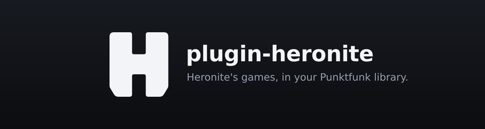

# @rafifos/plugin-heronite

[](https://biomejs.dev/) [](https://biomejs.dev) [](https://biomejs.dev)



A [Punktfunk](https://git.unom.io/unom/punktfunk) host plugin. It adds your
[Heronite](https://heronite.app) games to the host library and starts them through Heronite.
Heronite's Wine or Proton prefix, emulator profile, playtime and console mode then apply as they do
when you press **Play** in Heronite.

New to Punktfunk? [What is Punktfunk?](docs/punktfunk.md) explains the host and client model, how a
stream flows, and where plugins operate. New to Heronite? [What is Heronite?](docs/heronite.md)
describes the launcher that this plugin reads.

The plugin needs Heronite 1.8 and host 0.43 or later. An older host lists the games and ignores the
other features.

## What gets listed

- Every installed Heronite game that it can start: a Steam title, a store game from Epic, GOG or
  Amazon, a sideloaded executable, an emulator ROM, or a game that another launcher owns.
- Every game that Heronite is downloading. The entry shows as not installed with the size that
  Heronite recorded.
- A **Heronite** tile that opens Heronite's window, and a **Heronite Console** tile that opens its
  controller interface. You can switch off either tile in the settings. The console tile needs a
  known `heronite-rs`.

The plugin leaves out games that exist only in a store catalogue, hidden games, DLCs, browser titles
and the `zoom` runner. A copy group that you linked in Heronite appears once, as the first installed
copy.

### The two launcher tiles' marks

Both tiles name a brand-mark token: `heronite` for the desktop tile and `heronite-console` for
console mode. The host accepts no other value in that field. `icon` is a token that matches
`[a-z][a-z0-9-]{0,31}`, and each client resolves the token against the marks that it bundles. The
host rejects image bytes and URLs. The art slots cannot work around this, because the host's art
proxy serves raster containers only and refuses SVG. The web console renders library art in a
browser, and SVG is script-capable XML.

The art therefore belongs to the clients, not to a plugin. Heronite's mark is its `H`, the same mark
that its tray icons draw. The master copy is in [assets/heronite-marks](assets/heronite-marks), with
its provenance recorded there and outside the published package. No shipped client bundles
`heronite` yet, so both tiles render their name on an accent face. That is the same appearance as
before this mark was added. The tiles show the mark, with no release here, when
`assets/launcher-icons` gains it.

## Setup

**Linux package (deb, rpm, Arch):** you do not set anything. The plugin finds Heronite's data in
`~/.local/share/heronite` by itself, and launches use `heronite-rs` from `PATH`.

**AppImage:** set **Heronite program folder** to the folder that holds the AppImage, usually
`~/Applications`. The plugin runs the AppImage with Heronite's own flags. This keeps one long-lived
process that the host can follow, which is what a streamed session needs. Do not use the
`heronite://` scheme instead. An AppImage integration often registers no handler, and a hand-off
launch through `xdg-open` exits before anything appears. The `paths` verb prints which transport is
in use and warns when it uses the fallback.

**Flatpak:** you do not set anything. The plugin finds the data folder of the Flatpak
(`~/.var/app/app.heronite.Heronite/data/heronite`), and launches go through
`flatpak run app.heronite.Heronite`.

**Windows installer:** the plugin runner cannot read your profile by itself. The manifest names
`%APPDATA%\heronite\data`, so a current host opens it when the plugin installs. An older host asks
for it under **Library**, then **Game sources**, then Heronite. Windows is untested at this time.

**Portable copy, or a data folder in a different location:** set **Heronite data folder** to the
folder that holds `store` and `local_library`. If the program is not on `PATH`, set **Heronite
program folder** as well. That setting enables headless launches and the console tile on a portable
install.

Pause, cancel and remove stay in Heronite, because Heronite owns the files.

Streaming has its own page, because a streamed launch is where the launcher, the compositor and
the hooks meet:

- [Streaming a Heronite game](https://github.com/rafifos/punktfunk-plugin-heronite/wiki/Streaming-a-Heronite-game)
  covers the launch path, the hooks that make it reliable, the diagnostics log, HDR and 5.1 audio.
- [What sets WAYLAND_DISPLAY](https://github.com/rafifos/punktfunk-plugin-heronite/wiki/What-sets-WAYLAND_DISPLAY)
  covers the black-screen failure and the two settings that cause it.

## Install

```sh
punktfunk-host plugins add @rafifos/plugin-heronite --allow-public-registry
```

A package outside the `@punktfunk` scope needs `--allow-public-registry`. Remove it with
`punktfunk-host plugins remove @rafifos/plugin-heronite`.

## Develop

```sh
bun install
bun test
bunx tsc --noEmit
bunx biome check
bun run build          # dist/index.js and dist/cli.js
bun pm pack            # the tarball a host installs
```

The CLI operates on a real Heronite install, or on a folder that you select in the settings:

```sh
bun src/cli.ts detect          # present | absent
bun src/cli.ts scan --preview  # the entries a sync would push
bun src/cli.ts paths           # data root, file presence, entry and launcher counts
```

`detect`, `scan` and `paths` operate offline. `parity` and `uninstall` connect to an active host:

```sh
bun src/cli.ts parity --snapshot before.json   # capture the host's library for this store
bun src/cli.ts parity --compare before.json    # exits 1 when an entry changed
bun src/cli.ts uninstall                       # remove the entries and release the store claim
```

To test the offline verbs on the fixture, copy `test/fixtures/heronite-data` to
`$XDG_DATA_HOME/heronite`, or set the data folder in the plugin settings. Set
`HERONITE_TEST_DATA_DIR` to a real data root to find drift after a Heronite update. Nothing from
that folder is committed.

`src/heronite/*` is pure: paths go in, data comes out, and it uses no Effect runtime and no host
client. The tests therefore cover the parsers, the filters and the entry mapping without a host.
`src/kit/library-with-ui.ts` is the only module that connects to Punktfunk. It composes the exported
parts of the kit because `defineLibraryPlugin` owns the only `serveUi` call and cannot serve a
per-game tab. For that reason `@punktfunk/plugin-kit` is pinned to an exact version.

[ADR 0007](docs/adr/0007-pure-decode-layer-injected-io.md) explains why the decode layer has no
Effect and how its IO is injected.

## Releasing

[release-please](https://github.com/googleapis/release-please) owns the version, the changelog and
the tag. No version is set by hand. Write [Conventional Commits](https://www.conventionalcommits.org/)
on `main`. A `feat:` increases the minor version, a `fix:` increases the patch version, and a
`feat!:` increases the major version. The workflow opens or updates a _chore: release_ pull request:

| Workflow                                                   | Runs on                                          | Does                                                                                                                                       |
| ---------------------------------------------------------- | ------------------------------------------------ | ------------------------------------------------------------------------------------------------------------------------------------------ |
| [ci.yml](.github/workflows/ci.yml)                         | every push to `main` and every pull request      | Biome, `tsc --noEmit`, `bun test`, build, `npm pack --dry-run`                                                                             |
| [release-please.yml](.github/workflows/release-please.yml) | every push to `main`                             | opens the release PR; on merge, tags the commit and cuts the GitHub release, then calls `publish.yml`                                      |
| [publish.yml](.github/workflows/publish.yml)               | called by the release, or run by hand with a tag | builds the tag, refuses a tag that disagrees with `package.json`, skips a version already on the registry, then `npm publish --provenance` |

The CI run for the release pull request waits for a maintainer to approve it. GitHub treats a pull
request that `github-actions[bot]` opens as work from an outside collaborator. Approve the run, then
merge.

Tags have the form `v<version>`, because `include-component-in-tag` is off. `publish.yml` strips
that `v` and compares the rest with `package.json`.

Merge the release pull request to ship. The version in `package.json`, the changelog entry, the
`vX.Y.Z` tag and the npm package then agree. You can also give `publish.yml` a tag by hand
(_Actions_, then _Publish_, then _Run workflow_) to run a failed release again. A second run is
safe: a version that is already on the registry causes no operation.

The plugin definition has no version of its own. `pluginDef.version` reads `package.json`, and
`bun build` puts that value into `dist`. A release therefore reports the new version to the host
without a second location to change.

Publishing uses an **npm granular access token**, held in the `NPM_TOKEN` repository secret.
`--provenance` still signs an attestation, because that uses the job's `id-token: write` for the
Sigstore certificate, not the registry credential.

**Trusted publishing does not work for this repository.** GitHub issues the immutable OIDC subject
form (`repo:<owner>@<id>/<repo>@<id>:ref:…`) for every repository created after 2026-07-15, and the
registry cannot resolve that form to a trusted publisher. It answers:

```
HTTP 404: OIDC token exchange error - package not found
```

The package is on the registry, so the message names the wrong thing. [npm/cli#9969][9969] tracks
the defect. GitHub accepts a request to go back to the older subject format and then keeps the new
one, so there is nothing to change here. Switch back to trusted publishing, and delete the secret,
when that issue closes and a run logs `credential: OIDC (trusted publishing)`.

[9969]: https://github.com/npm/cli/issues/9969

A version that is already on the registry causes no operation, and a version that failed to publish
is still absent, so a re-run publishes it. A manual publish has no attestation, and npm does not let
you publish a version again to add one, so repairing a hand-published version costs a patch
release.

### The first version, once

A token cannot be scoped to a package that does not exist yet, so the first version needs one manual
publish. Publish the real version, not a placeholder. npm versions are immutable, so a `0.0.0`
stays in the version list. Merge the release pull request first, then run this from the tag:

```sh
git checkout v0.1.0
npm login                 # 2FA prompt
bun install --frozen-lockfile
npm publish --access public
```

`prepublishOnly` builds `dist`, so the tarball agrees with the tag. A local publish cannot attach
provenance, because that needs a CI identity. That first version therefore has no attestation.

The version you bootstrap has to exist before a token can be scoped to it, so create the token
afterwards and add it as the `NPM_TOKEN` repository secret:

```sh
# npmjs.com, Access Tokens, Generate New Token, Granular Access Token
#   Packages and scopes: @rafifos/plugin-heronite, read and write
gh secret set NPM_TOKEN --repo rafifos/punktfunk-plugin-heronite
```

Every release after that goes through `publish.yml` and carries an attestation.

`bootstrap-sha` in `release-please-config.json` is `d537e40`. That is the parent of `190d767`, the
first commit of this repository's own history. Every changelog therefore starts at `190d767` and
never includes the Hydra-era commits before the fork point. The option is at the root level. Inside
`packages."."` release-please ignores it and reads the full history.

The repository must stay public, because npm publishes provenance attestations only for public
repositories.

## Downloads

Heronite operates its own store downloads, so the host's Downloads list shows Heronite's queue and
does not control it. The list can show only what Heronite stores in `store/download-manager.json`:

- **No percentage, speed or ETA.** Heronite writes the file at queue changes, not while data moves.
  A row has the size that Heronite recorded and, when the download is complete, that size as the
  done size. There is no intermediate value to calculate.
- **A killed Heronite keeps its last state on disk.** If Heronite stops during a download, the title
  stays `downloading` or `paused` until Heronite writes the file again. The plugin cannot find out
  that no data moves.
- **A launch waits only for a title that Heronite already downloads.** A game that shows as missing
  starts only while Heronite reports it as `downloading`, `queued` or `installing`. The host waits
  and then starts it. In all other cases the host refuses the launch and tells you to start the
  download in Heronite. Pause, cancel and remove always refuse, because Heronite owns the files.

## Per-game tab

Each entry of the plugin opens a read-only tab. It shows Heronite's own playtime and first and last
play time from `store/timestamp.json` and `local_library/sessions.json`. It also shows the
completion status from `local_library/statuses.json`. The tab has a short status list and an empty
form. Saving does nothing, because the plugin never writes to the files of Heronite.

## History

This repository began as the upstream Hydra plugin and was retargeted in place. Hydra support is
removed. Library ids changed from `hydra:*` to `heronite:*`, so pins, art caches and GameStream app
ids from the Hydra plugin do not continue. See
[ADR-0002](docs/adr/0002-retarget-in-place-drop-hydra.md) and the
[0.1.0 release note](docs/release-0.1.0.md).

## Use of AI

This project uses AI to write code.

Licensed MIT OR Apache-2.0.
